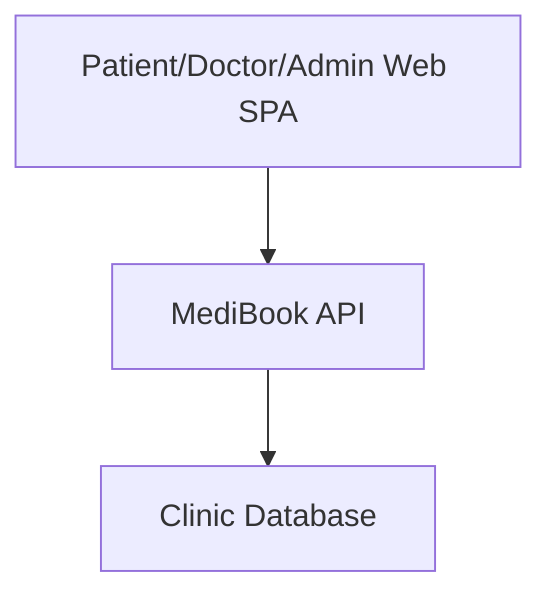
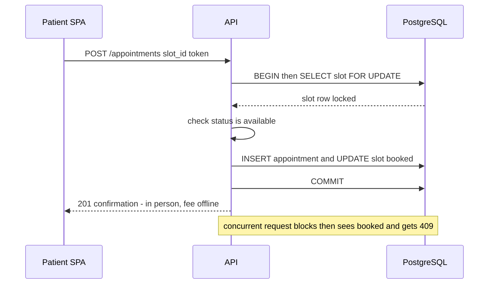
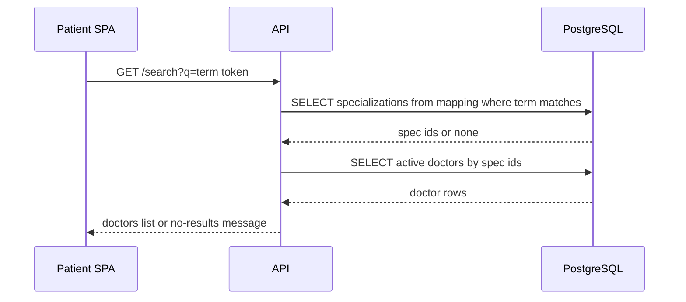
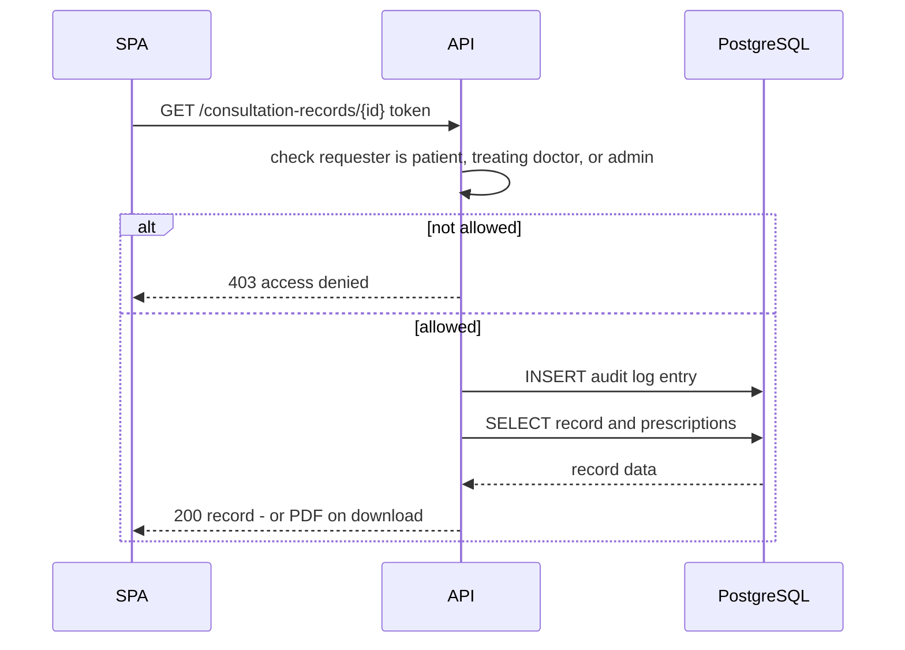
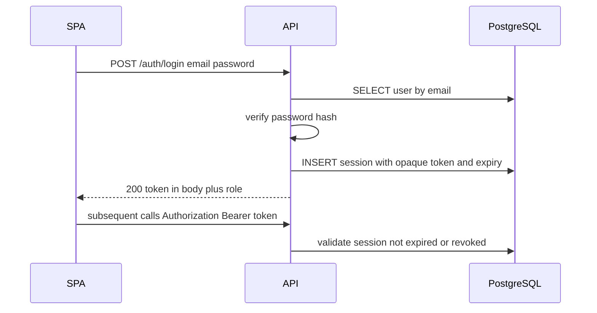
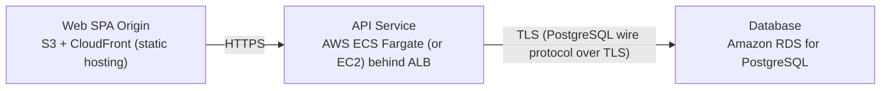

# Architecture

> Maintained by QuorQ AI SDLC. Text between `sdlc:auto` markers is regenerated; anything outside them is yours and is kept.

<!-- sdlc:auto:start narrative -->
## Overview

### ARCH-001 · approved · source: architecture:summary

MediBook V2 is architected as a single-clinic healthcare appointment platform: React 19 SPA, FastAPI 0.115 backend, PostgreSQL 16 on AWS Mumbai. Core guarantees are no-AI disease/symptom-to-specialization search, concurrency-safe slot booking via row-level locking, and audited access to consultation records.

Approved architecture, version 1. Patients self-register with consent, search for care via a predefined admin-maintained mapping table (no AI/ML), and book/reschedule/cancel fixed-length in-person slots; no-double-booking is enforced with PostgreSQL row-level locking inside a transaction. Doctors define recurring weekly availability split into bookable slots, manage schedules, and keep structured consultation records with prescriptions patients can view and download as a generated PDF. Admins manage doctors, specializations, the mapping, and appointments. Sign-in uses server-side opaque-token sessions (SPA and API on separate origins) with role-based access, password hashing, encryption in transit and at rest, and audit logging of consultation-record access. AWS Mumbai (ap-south-1) region chosen to keep patient health data in India for DPDP Act alignment. Explicitly out of scope: email, queues, payments, uploads, telemedicine, and any payment gateway.

### ARCH-002 · approved · source: architecture:components:web

The Patient/Doctor/Admin Web SPA is the single React 19 front end serving all three roles.

Responsive React 19 SPA covering patient search/booking, doctor schedule and consultation-record editing, and the admin dashboard. Stores the opaque session token and sends it as 'Authorization: Bearer' on every API call. Reads the API base URL from the VITE_API_BASE_URL environment variable. Served as a static build from its own CloudFront origin, separate from the API origin.

**Related:** US-001, US-002, US-005

### ARCH-003 · approved · source: architecture:components:api

The MediBook API (FastAPI 0.115) holds all business logic for the platform.

Owns authentication/sessions, role-based access control, mapping-based search, slot generation, concurrency-safe booking via row-level locking, consultation records, server-side PDF generation of prescriptions, and audit logging of record access.

**Related:** US-002, US-005, US-016, US-021, US-023

### ARCH-004 · approved · source: architecture:components:db

PostgreSQL 16 is the single system of record for all clinic data.

Stores users, sessions, specializations, disease/symptom mapping, availability, slots, appointments, consultation records, prescriptions, consent, and the audit log. Enforces atomic slot booking via row locks (FOR UPDATE) and holds encryption at rest.

### ARCH-005 · approved · source: architecture:critical_paths:booking

Concurrency-safe appointment booking guarantees only one patient can claim a given slot.

Patient confirms an available slot. The API opens a transaction, locks the slot row FOR UPDATE, verifies it is still available, creates the appointment, marks the slot booked, and commits. A concurrent request waits on the lock, then finds the slot already booked, so only one booking succeeds. Booking a no-longer-available slot returns 409 at the POST /appointments endpoint.

**Related:** AC-021, AC-022, NFR-011

### ARCH-006 · approved · source: architecture:critical_paths:search

Patients search for care by disease, symptom, or specialization through a predefined, admin-maintained mapping table -- no AI/ML involved.

A signed-in patient submits a term. The API looks it up in the predefined mapping table using an exact/normalized match (no AI), resolves it to one or more specializations, and lists active doctors with those specializations. An unmatched term returns an empty result with a no-results flag, surfaced at GET /search.

**Related:** US-005, AC-018

### ARCH-007 · approved · source: architecture:critical_paths:record_access

Viewing or downloading a consultation record is authorized per-request and always audit-logged.

Patient (or treating doctor/admin) opens a consultation record. The API authorizes the requester as the patient, the treating doctor, or an admin; writes an audit entry (who, which record, when); returns the record; and generates a PDF on download. Covered by GET /consultation-records/{id} and GET /consultation-records/{id}/pdf, with audit entries reviewable via GET /admin/audit/record-access.

**Related:** US-016, US-021, US-023, AC-043, AC-056

### ARCH-008 · approved · source: architecture:critical_paths:auth

Sign-in and session lifecycle use server-side opaque tokens rather than JWTs, with explicit revocation.

User signs in with email/password; the API verifies the password hash, creates a server-side session with a random opaque token and expiry, and returns the token in the response body. Each subsequent request validates the token and refreshes last-active timestamp. Sign-out and doctor deactivation both revoke sessions server-side. Login failures use a generic message that reveals neither which field was wrong.

**Related:** US-002, NFR-002, NFR-003

### ARCH-009 · approved · source: architecture:entities

The relational data model spans users/sessions, specialization mapping, availability/slots, appointments, and consultation/prescription records with an access audit log.

Entities: users (id, role, full_name, email, password_hash, is_active, created_at); patient_consents (id, user_id, consent_given, consent_date, consent_text_version); doctor_profiles (id, user_id, credentials, must_reset_password); specializations (id, name); doctor_specializations (doctor_id, specialization_id); symptom_mappings (id, term, term_type, normalized_term); mapping_specializations (mapping_id, specialization_id); availability_patterns (id, doctor_id, weekday, start_time, end_time, slot_length_minutes, is_active); slots (id, doctor_id, pattern_id, start_at, end_at, status); appointments (id, slot_id, patient_id, doctor_id, status, created_at, updated_at); consultation_records (id, appointment_id, patient_id, doctor_id, diagnosis, visit_notes, created_at); prescription_lines (id, consultation_record_id, medicine, dosage, frequency, duration); sessions (id, user_id, token_hash, created_at, last_active_at, expires_at, revoked_at); record_access_audit (id, user_id, consultation_record_id, action, accessed_at).

**Related:** US-002, US-005, US-016, US-021

### ARCH-010 · approved · source: architecture:endpoints:auth_patient

Auth and patient-facing endpoints cover registration, sign-in/out, search, slot listing, booking, and the patient appointment dashboard.

POST /auth/register: patient self-registration with mandatory consent, creates a patient account only, signs in; rejects duplicate email and missing consent. POST /auth/login: email/password sign-in, returns opaque session token in body, generic failure message. POST /auth/logout: revokes current session server-side. GET /search: mapping-based disease/symptom/specialization lookup, no AI, empty result with no-results flag when unmatched. GET /doctors/{id}/slots: lists a doctor's currently available fixed-length slots, real-time. POST /appointments: books an available slot with row-lock concurrency protection, returns in-person fee-offline confirmation, 409 if slot no longer available. PATCH /appointments/{id}/reschedule: moves appointment to another available slot within the configured window, releases old slot, blocked past cut-off. PATCH /appointments/{id}/cancel: cancels an upcoming appointment within the window, frees the slot, blocked past cut-off, admin may also cancel. GET /me/appointments: patient dashboard of upcoming and past appointments with doctor, specialization, date/time, status, empty-state when none.

**Related:** US-001, US-002, US-005

### ARCH-011 · approved · source: architecture:endpoints:doctor

Doctor-facing endpoints cover availability management, the appointment dashboard, status updates, consultation records, and prescriptions.

POST /doctor/availability: defines recurring weekly availability, system generates fixed-length bookable slots; removing a period with existing bookings warns and does not silently delete. GET /doctor/appointments: doctor dashboard of upcoming/past appointments with patient name, date/time, status. PATCH /doctor/appointments/{id}/status: sets appointment outcome to completed or no-show, prevents invalid transitions (e.g. from cancelled). POST /appointments/{id}/consultation: treating doctor records diagnosis and visit notes against the appointment and patient, no attachment/upload option. POST /consultation-records/{id}/prescriptions: adds structured prescription lines (medicine, dosage, frequency, duration), each required field must be present. GET /consultation-records/{id} and GET /consultation-records/{id}/pdf: view/download a record and prescription, restricted to patient/treating doctor/admin, access is audit-logged.

**Related:** US-016, US-021, US-023

### ARCH-012 · approved · source: architecture:endpoints:admin

Admin endpoints cover doctor provisioning, specialization and mapping maintenance, cross-doctor appointment visibility, consent review, and audit review.

POST /admin/doctors: provisions a doctor account with name, email, credentials, and one or more specializations (at least one required); first-login password set to <set-at-first-login>. PATCH /admin/doctors/{id}: edits or deactivates a doctor; deactivation removes the doctor from search and revokes their sessions. POST /admin/specializations: creates/edits/removes specializations; removal of a referenced specialization warns about dependencies. POST /admin/mappings: maintains the predefined disease/symptom-to-specialization mapping; changes reflect in subsequent searches. GET /admin/appointments: views appointments across doctors, filterable by doctor or date, with patient, doctor, date/time, status. GET /admin/audit/record-access: reviews consultation-record access audit entries (who, which record, when). GET /admin/patients/{id}/consent: views whether and when a patient gave data-handling consent.

### ARCH-013 · approved · source: architecture:deployment_nodes

Three deployment nodes: a static SPA origin, a containerized/compute API service behind a load balancer, and a managed Postgres database, all in AWS Mumbai.

Web SPA Origin: S3 + CloudFront static hosting of the React 19 static build. API Service: AWS ECS Fargate (or EC2) behind an ALB, running FastAPI 0.115 on Python/Uvicorn. Database: Amazon RDS for PostgreSQL 16, in the Mumbai (ap-south-1) region.

### ARCH-014 · approved · source: architecture:technology:frontend

React 19 was chosen over Vue/Angular as the approved frontend stack.

Drives the three role-based interactive views (patient search/booking, doctor schedule and record editor, admin dashboard) as a responsive SPA served from its own CloudFront origin, reading the API base URL from VITE_API_BASE_URL and sending an Authorization: Bearer token on every call.

**Related:** US-001, US-016, US-021

### ARCH-015 · approved · source: architecture:technology:backend

FastAPI 0.115 was chosen over Django/Flask as the approved backend framework.

Hosts the booking transaction with PostgreSQL row-level locking for the one-patient-per-slot guarantee, the patient/doctor/admin role checks, audit logging of record access, and server-side PDF generation of prescriptions.

**Related:** US-016

### ARCH-016 · approved · source: architecture:technology:database

PostgreSQL 16 was chosen over MySQL/SQL Server as the approved database.

Row-level locking and transactions make the no-double-booking guarantee real; one consistent store holds the disease/symptom mapping, slots, consultation records, consent, and audit log; term search runs as a direct normalized query with no added search engine.

### ARCH-017 · approved · source: architecture:technology:cloud

AWS was chosen over Azure/GCP as the approved cloud provider, deployed in the Mumbai region for data-residency alignment.

The Mumbai (ap-south-1) region keeps patient health data inside India for DPDP alignment (NFR-009), provides TLS for encryption in transit, managed RDS PostgreSQL with encryption at rest, and compute for the API -- covering the whole footprint without a separate email or queue service, both of which are out of scope.

**Related:** NFR-009
<!-- sdlc:auto:end narrative -->

<!-- sdlc:auto:start building-blocks -->
## Building Block View

| ID | Name | Technology | Responsibility | Depends on |
|---|---|---|---|---|
| web | Patient/Doctor/Admin Web SPA | React 19 | Responsive React UI for patient search/booking, doctor schedule and consultation records, and admin dashboard. Stores the opaque session token and sends it as Authorization: Bearer on every API call. Reads API base URL from VITE_API_BASE_URL. | api |
| api | MediBook API | FastAPI 0.115 | FastAPI backend holding all business logic: auth/sessions, role-based access, search via mapping lookup, slot generation, concurrency-safe booking with row-level locking, consultation records, PDF generation, and audit logging. | db |
| db | Clinic Database | PostgreSQL 16 | PostgreSQL store for users, sessions, specializations, disease/symptom mapping, availability, slots, appointments, consultation records, prescriptions, consent, and audit log. Enforces atomic slot booking via row locks and holds encryption at rest. | — |

<!-- sdlc:auto:end building-blocks -->

<!-- sdlc:auto:start runtime -->
## Runtime View

### Concurrency-safe appointment booking

Patient confirms an available slot. The API opens a transaction, locks the slot row FOR UPDATE, verifies it is still available, creates the appointment, marks the slot booked, and commits. A concurrent request waits on the lock and then finds the slot booked, so only one booking succeeds (AC-021, AC-022, NFR-011).

- **Components:** api, db
- **Modules:** booking, slots, appointments
- **Key functions:** book_slot(patient_id, slot_id), lock_slot_for_update(slot_id), create_appointment(patient_id, slot_id), release_slot(slot_id)

### Search care by disease/symptom via mapping

Signed-in patient submits a term. The API looks it up in the predefined mapping table (exact/normalized match, no AI), resolves to one or more specializations, and lists active doctors with those specializations. An unmatched term returns an empty result with a no-results flag (US-005, AC-018).

- **Components:** web, api, db
- **Modules:** search, mapping, doctors
- **Key functions:** resolve_term_to_specializations(term), list_doctors_by_specializations(spec_ids)

### View and download consultation record with audit log

Patient (or treating doctor/admin) opens a consultation record. The API authorizes the requester against patient/treating-doctor/admin, writes an audit entry (who, which record, when), returns the record, and generates a PDF on download (US-016, US-021, US-023, AC-043, AC-056).

- **Components:** web, api, db
- **Modules:** records, authz, audit, pdf
- **Key functions:** authorize_record_access(user, record), write_audit_entry(user_id, record_id), get_consultation_record(record_id), render_record_pdf(record)

### Opaque-token sign-in and session lifecycle

User signs in with email/password. The API verifies the hash, creates a server-side session with a random opaque token and expiry, and returns the token in the body. Each request validates the token and refreshes last-active. Sign-out and doctor deactivation revoke sessions server-side (US-002, NFR-002, NFR-003).

- **Components:** web, api, db
- **Modules:** auth, sessions
- **Key functions:** authenticate(email, password), create_session(user_id), validate_session(token), revoke_session(token), revoke_user_sessions(user_id)

<!-- sdlc:auto:end runtime -->

<!-- sdlc:auto:start deployment-view -->
## Deployment View

| Name | Service | Runtime | Scaling | Environment |
|---|---|---|---|---|
| Web SPA Origin | S3 + CloudFront (static hosting) | React 19 static build | CDN edge, static | dev |
| API Service | AWS ECS Fargate (or EC2) behind ALB | FastAPI 0.115 on Python / Uvicorn | 1-2 small tasks, single-clinic scale | dev |
| Database | Amazon RDS for PostgreSQL | PostgreSQL 16, Mumbai (ap-south-1) region | single instance, correctness-first | dev |

| Source | Target | Protocol |
|---|---|---|
| Web SPA Origin | API Service | HTTPS |
| API Service | Database | TLS (PostgreSQL wire protocol over TLS) |

<!-- sdlc:auto:end deployment-view -->

<!-- sdlc:auto:start decisions -->
## Architecture Decisions

| Layer | Choice | ADR |
|---|---|---|
| Frontend | React 19 | [ADR-0001](adr/frontend.md) |
| Backend | FastAPI 0.115 | [ADR-0002](adr/backend.md) |
| Database | PostgreSQL 16 | [ADR-0003](adr/database.md) |
| Cloud | AWS | [ADR-0004](adr/cloud.md) |
<!-- sdlc:auto:end decisions -->

<!-- sdlc:auto:start links -->
## Related Documents

- [Data Model](data-model.md)
- [API Specification](api/openapi.yaml)
- [Architecture Decision Records](adr/README.md)
<!-- sdlc:auto:end links -->
