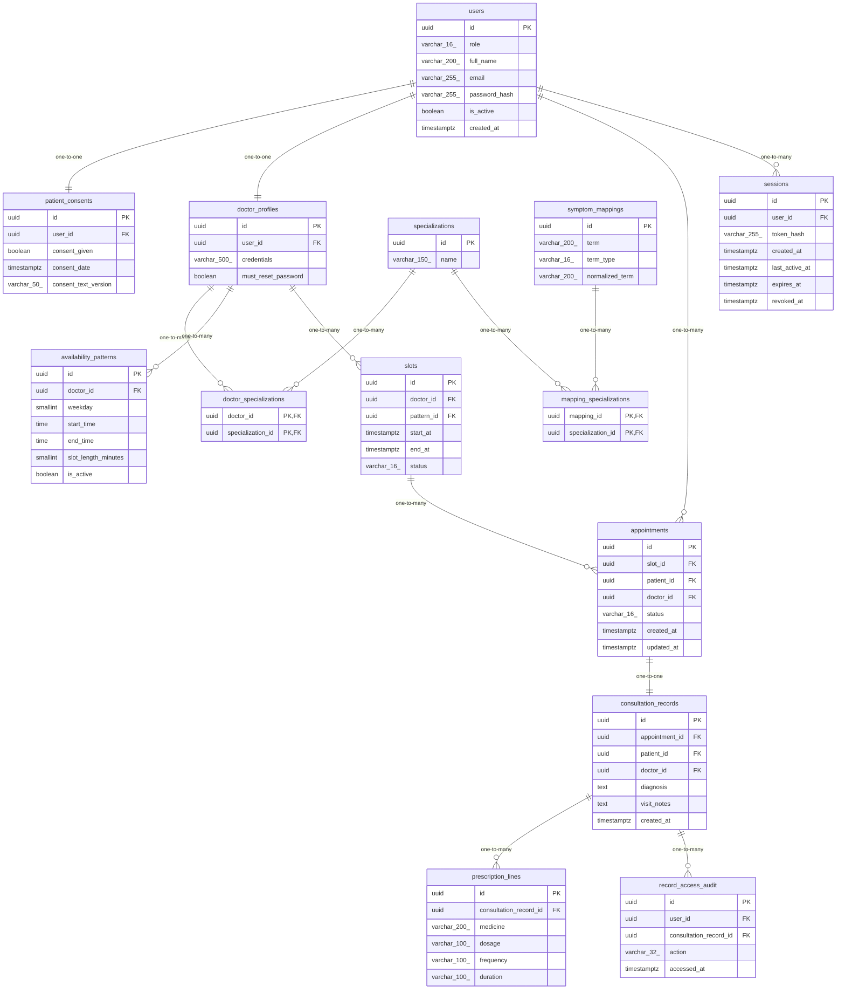

# Data Model

<!-- sdlc:auto:start entities -->
### users

| Field | Type | PK | FK | Nullable |
|---|---|---|---|---|
| id | uuid | True | — | False |
| role | varchar(16) | False | — | False |
| full_name | varchar(200) | False | — | False |
| email | varchar(255) | False | — | False |
| password_hash | varchar(255) | False | — | False |
| is_active | boolean | False | — | False |
| created_at | timestamptz | False | — | False |

### patient_consents

| Field | Type | PK | FK | Nullable |
|---|---|---|---|---|
| id | uuid | True | — | False |
| user_id | uuid | False | users.id | False |
| consent_given | boolean | False | — | False |
| consent_date | timestamptz | False | — | False |
| consent_text_version | varchar(50) | False | — | False |

### doctor_profiles

| Field | Type | PK | FK | Nullable |
|---|---|---|---|---|
| id | uuid | True | — | False |
| user_id | uuid | False | users.id | False |
| credentials | varchar(500) | False | — | True |
| must_reset_password | boolean | False | — | False |

### specializations

| Field | Type | PK | FK | Nullable |
|---|---|---|---|---|
| id | uuid | True | — | False |
| name | varchar(150) | False | — | False |

### doctor_specializations

| Field | Type | PK | FK | Nullable |
|---|---|---|---|---|
| doctor_id | uuid | True | doctor_profiles.id | False |
| specialization_id | uuid | True | specializations.id | False |

### symptom_mappings

| Field | Type | PK | FK | Nullable |
|---|---|---|---|---|
| id | uuid | True | — | False |
| term | varchar(200) | False | — | False |
| term_type | varchar(16) | False | — | False |
| normalized_term | varchar(200) | False | — | False |

### mapping_specializations

| Field | Type | PK | FK | Nullable |
|---|---|---|---|---|
| mapping_id | uuid | True | symptom_mappings.id | False |
| specialization_id | uuid | True | specializations.id | False |

### availability_patterns

| Field | Type | PK | FK | Nullable |
|---|---|---|---|---|
| id | uuid | True | — | False |
| doctor_id | uuid | False | doctor_profiles.id | False |
| weekday | smallint | False | — | False |
| start_time | time | False | — | False |
| end_time | time | False | — | False |
| slot_length_minutes | smallint | False | — | False |
| is_active | boolean | False | — | False |

### slots

| Field | Type | PK | FK | Nullable |
|---|---|---|---|---|
| id | uuid | True | — | False |
| doctor_id | uuid | False | doctor_profiles.id | False |
| pattern_id | uuid | False | availability_patterns.id | True |
| start_at | timestamptz | False | — | False |
| end_at | timestamptz | False | — | False |
| status | varchar(16) | False | — | False |

### appointments

| Field | Type | PK | FK | Nullable |
|---|---|---|---|---|
| id | uuid | True | — | False |
| slot_id | uuid | False | slots.id | False |
| patient_id | uuid | False | users.id | False |
| doctor_id | uuid | False | doctor_profiles.id | False |
| status | varchar(16) | False | — | False |
| created_at | timestamptz | False | — | False |
| updated_at | timestamptz | False | — | False |

### consultation_records

| Field | Type | PK | FK | Nullable |
|---|---|---|---|---|
| id | uuid | True | — | False |
| appointment_id | uuid | False | appointments.id | False |
| patient_id | uuid | False | users.id | False |
| doctor_id | uuid | False | doctor_profiles.id | False |
| diagnosis | text | False | — | True |
| visit_notes | text | False | — | True |
| created_at | timestamptz | False | — | False |

### prescription_lines

| Field | Type | PK | FK | Nullable |
|---|---|---|---|---|
| id | uuid | True | — | False |
| consultation_record_id | uuid | False | consultation_records.id | False |
| medicine | varchar(200) | False | — | False |
| dosage | varchar(100) | False | — | False |
| frequency | varchar(100) | False | — | False |
| duration | varchar(100) | False | — | False |

### sessions

| Field | Type | PK | FK | Nullable |
|---|---|---|---|---|
| id | uuid | True | — | False |
| user_id | uuid | False | users.id | False |
| token_hash | varchar(255) | False | — | False |
| created_at | timestamptz | False | — | False |
| last_active_at | timestamptz | False | — | False |
| expires_at | timestamptz | False | — | False |
| revoked_at | timestamptz | False | — | True |

### record_access_audit

| Field | Type | PK | FK | Nullable |
|---|---|---|---|---|
| id | uuid | True | — | False |
| user_id | uuid | False | users.id | False |
| consultation_record_id | uuid | False | consultation_records.id | False |
| action | varchar(32) | False | — | False |
| accessed_at | timestamptz | False | — | False |
<!-- sdlc:auto:end entities -->

<!-- sdlc:auto:start relationships -->
| Source | Target | Type |
|---|---|---|
| users | patient_consents | one-to-one |
| users | doctor_profiles | one-to-one |
| doctor_profiles | doctor_specializations | one-to-many |
| specializations | doctor_specializations | one-to-many |
| symptom_mappings | mapping_specializations | one-to-many |
| specializations | mapping_specializations | one-to-many |
| doctor_profiles | availability_patterns | one-to-many |
| doctor_profiles | slots | one-to-many |
| slots | appointments | one-to-many |
| users | appointments | one-to-many |
| appointments | consultation_records | one-to-one |
| consultation_records | prescription_lines | one-to-many |
| users | sessions | one-to-many |
| consultation_records | record_access_audit | one-to-many |
<!-- sdlc:auto:end relationships -->

<!-- sdlc:auto:start er-diagram -->

<!-- sdlc:auto:end er-diagram -->
